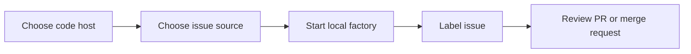

# Software Factory quickstart

<a id="dark-factory-quickstart"></a>

Try the factory on a laptop. This article covers GitHub, GitLab, and Jira Cloud
issues with their supported PR or merge request hosts. For an organizational
installation, use the [administrator guide](factory-admin-guide.md).



## Choose your tracker and code host

Pick where code lives, then where issues live:

| Code and result | Issue source | Setup below |
| --- | --- | --- |
| GitHub PR | GitHub issues | [GitHub](#github-issues-and-github-prs) |
| GitHub PR | Jira Cloud issues | [Jira and GitHub](#jira-cloud-issues-and-github-prs) |
| GitLab merge request | GitLab issues | [GitLab](#gitlab-issues-and-merge-requests) |

Jira Cloud can also pair with [Bitbucket](factory-quickstart-reference.md#run-quickstart-for-bitbucket).
Jira Cloud with GitLab has [no supported installation path](../capabilities.md#workspaces-and-integrations).

## What you need

- Docker running with at least **16 GiB** allocated, kind v0.24 or later,
  kubectl, Helm, and a released Curie CLI.
- An Anthropic or OpenRouter model credential with available credit.
- A small code repository with an initial commit and a passing baseline.

Use interactive Bash. Keep the same terminal and trial variables through
cleanup. Each path uses polling, so no webhook or tunnel is needed. See
[platform limits](factory-quickstart-reference.md#what-you-need).

## Install Curie

```bash
curl -fsSL https://raw.githubusercontent.com/curie-eng/curie/main/get-curie.sh | bash
if [ -w /usr/local/bin ]; then
  export PATH="/usr/local/bin:$PATH"
else
  export PATH="$HOME/.local/bin:$PATH"
fi
hash -r
curie --version
```

Use a released CLI; a source build has no published factory runner image.
See [installation details](factory-quickstart-reference.md#install-curie).

## Prepare an isolated trial

Enter a model key and use the documented default models for its provider:

```bash
read -r -s -p "Model API key: " CURIE_CREDENTIALS
printf '\n'
export CURIE_CREDENTIALS
case "$CURIE_CREDENTIALS" in
  sk-ant-*) CURIE_MODEL=claude-sonnet-5-5; CURIE_REVIEWER_MODEL=claude-opus-5-5 ;;
  sk-or-*) CURIE_MODEL=z-ai/glm-5.3-flash; CURIE_REVIEWER_MODEL=openai/gpt-6.1-sol ;;
  *) printf 'Use an Anthropic or OpenRouter key.\n'; false ;;
esac
```

Continue only if that block succeeds. Make a separate kubeconfig and unique
kind cluster. Enter `owner/name` for GitHub or `group/subgroup/project` for GitLab:

```bash
CURIE_PREVIOUS_KUBECONFIG=${KUBECONFIG-}
CURIE_HAD_KUBECONFIG=${KUBECONFIG+x}
CURIE_TRIAL_KUBECONFIG=$(mktemp)
export KUBECONFIG="$CURIE_TRIAL_KUBECONFIG"
CURIE_KIND_NAME="curie-factory-$(date +%s)-$RANDOM"
CURIE_CONTEXT="kind-$CURIE_KIND_NAME"
read -r -p "Code repository path: " CURIE_REPO
```

Do not repeat this initialization when retrying a setup command.

## Set up the code host

**GitHub PRs:** Use an account that can create and install a GitHub App on the
repository. The first quickstart command prints a prefilled App link. Create
the App, generate its private key, and install it on the repository. The second
command finishes setup with the App ID and key.

**GitLab merge requests:** Enable issues on the project. Save a token from a
user with Developer access or higher in a file outside the repository. It needs
`api` and `write_repository` scopes. GitLab does not need a GitHub App. See
[GitLab setup](factory-gitlab-quickstart.md) for self-managed servers.

## Set up the issue source

| Issues | What to prepare |
| --- | --- |
| GitHub | Use the same repository as the PR. An authorized human will add the `curie-factory` label. |
| Jira Cloud | Prepare a [Jira factory account and token file](factory-jira-github-quickstart.md#prepare-the-repository-jira-account-and-tools) plus an authorized human's Jira `accountId`. |
| GitLab | Use the same project as the merge request. An authorized human will add the `curie-factory` label. |

## Start the factory

Run **one** of these paths with the repository and cluster variables above.

### GitHub issues and GitHub PRs

```bash
curie factory quickstart --repo "$CURIE_REPO" \
  --kind-name "$CURIE_KIND_NAME" --model "$CURIE_MODEL"
```

Confirm the printed context equals `$CURIE_CONTEXT`. Create and install the
App using the printed link, then complete setup:

```bash
read -r -p "GitHub App ID: " CURIE_APP_ID
read -r -p "App key file (absolute path): " CURIE_APP_KEY_FILE
curie factory quickstart --repo "$CURIE_REPO" --context "$CURIE_CONTEXT" \
  --model "$CURIE_MODEL" --app-id "$CURIE_APP_ID" \
  --private-key-file "$CURIE_APP_KEY_FILE"
```

### Jira Cloud issues and GitHub PRs

Prepare the Jira factory account, token file, and authorized human
[as described here](factory-jira-github-quickstart.md#prepare-the-repository-jira-account-and-tools).
Then enter the values:

```bash
read -r -p "Jira API URL for this token: " CURIE_JIRA_URL
read -r -p "Jira factory account email: " CURIE_JIRA_EMAIL
read -r -p "Jira token file (absolute path): " CURIE_JIRA_TOKEN_FILE
read -r -p "Authorized human Jira accountId: " CURIE_START_ACCOUNT
chmod 600 -- "$CURIE_JIRA_TOKEN_FILE"
```

The first pass prints the GitHub App link:

```bash
curie factory quickstart --tracker jira-cloud --code-host github \
  --repo "$CURIE_REPO" --forge-url "$CURIE_JIRA_URL" \
  --token-file "$CURIE_JIRA_TOKEN_FILE" --forge-username "$CURIE_JIRA_EMAIL" \
  --start-account "$CURIE_START_ACCOUNT" --kind-name "$CURIE_KIND_NAME" \
  --model "$CURIE_MODEL"
```

Confirm the printed context equals `$CURIE_CONTEXT`. Create and install the
App using the printed link. Then enter its ID and key path:

```bash
read -r -p "GitHub App ID: " CURIE_APP_ID
read -r -p "App key file (absolute path): " CURIE_APP_KEY_FILE
curie factory quickstart --tracker jira-cloud --code-host github \
  --repo "$CURIE_REPO" --forge-url "$CURIE_JIRA_URL" \
  --token-file "$CURIE_JIRA_TOKEN_FILE" --forge-username "$CURIE_JIRA_EMAIL" \
  --start-account "$CURIE_START_ACCOUNT" --context "$CURIE_CONTEXT" \
  --model "$CURIE_MODEL" --app-id "$CURIE_APP_ID" \
  --private-key-file "$CURIE_APP_KEY_FILE"
```

### GitLab issues and merge requests

Save a GitLab token with the required scopes in a file outside the repository.
Use its web base URL, such as `https://gitlab.com`:

```bash
read -r -p "GitLab web base URL: " CURIE_GITLAB_URL
read -r -p "GitLab token file (absolute path): " CURIE_GITLAB_TOKEN_FILE
chmod 600 -- "$CURIE_GITLAB_TOKEN_FILE"
curie factory quickstart --code-host gitlab --tracker gitlab \
  --repo "$CURIE_REPO" --forge-url "$CURIE_GITLAB_URL" \
  --token-file "$CURIE_GITLAB_TOKEN_FILE" --kind-name "$CURIE_KIND_NAME" \
  --model "$CURIE_MODEL"
```

Confirm the printed context equals `$CURIE_CONTEXT`.

## Check the result

For your chosen path, pin the reviewer model before selecting an issue:

```bash
curie cluster overrides dark-factory --context "$CURIE_CONTEXT" \
  --model "$CURIE_MODEL" --reviewer-model "$CURIE_REVIEWER_MODEL"
curie cluster status --context "$CURIE_CONTEXT"
```

Confirm `Factory quickstart ready` or a successful GitLab quickstart,
then create a small issue with a clear check. One example is to request
`greeting.md` with exactly `# Hello, factory` and a final newline, checked
with `printf '# Hello, factory\n' | cmp - greeting.md`. Add `curie-factory` as an
authorized human. On GitHub this requires repository write or admin access;
on GitLab it requires Developer access or higher; on Jira use the allowed
`accountId`. Wait for the status comment and linked PR or merge request.
Read the final `Completed:` or `Could not complete:` status after CI.
An open PR or merge request alone is not completion. The
[user guide](factory-user-guide.md) shows a GitHub example.

## Clean up

Remove the trigger label and wait for active work to stop. Closing a GitHub
or GitLab issue, or moving a Jira ticket to Done, also cancels. Then delete
only this trial cluster:

```bash
kind delete cluster --name "$CURIE_KIND_NAME"
rm -f -- "$CURIE_TRIAL_KUBECONFIG"
if [ "$CURIE_HAD_KUBECONFIG" = x ]; then
  export KUBECONFIG="$CURIE_PREVIOUS_KUBECONFIG"
else
  unset KUBECONFIG
fi
unset CURIE_CREDENTIALS
```

Remove a trial-only GitHub App, key, or provider token when no longer needed.
For recovery, CI behavior, existing clusters, and rare pairings, use the
[setup reference](factory-quickstart-reference.md).
