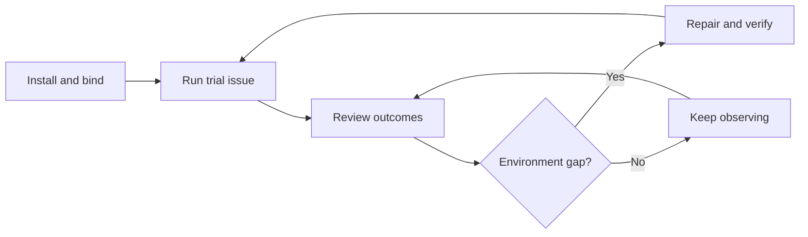

# Software Factory administrator guide

Install a factory, prepare its repository runner, and improve it from
observed outcomes. Developers then use the [user guide](factory-user-guide.md).



## Set up the factory

1. Choose a [supported tracker and code host](dark-factory-quickstart.md#choose-your-tracker-and-code-host).
   For a local trial, you need Docker, kind, kubectl, Helm, a released Curie
   CLI, and an Anthropic or OpenRouter credential. Allocate at least 16 GiB
   to Docker Desktop.
2. Follow the [quickstart](dark-factory-quickstart.md) for that pairing.
   For GitHub, its first command prints a GitHub App registration link.
   Create the App, save its key, install it on the repository, then
   [rerun with the App](dark-factory-quickstart.md#rerun-with-the-app).
3. Confirm `Factory quickstart ready` names the right context, repository,
   label, and runner. Run a small trial issue and read its final status and
   PR. On GitHub, a user with repository write or admin access adds the
   default `curie-factory` label.

Use [operations](../operations.md) and the
[factory bundle reference](../../examples/dark-factory/README.md#deploy-it-as-the-factory-agent)
for production settings.

## Prepare a repository runner

Install the local skills in the repository checkout:

```bash
curie factory skills install --help && curie factory skills install --agent codex
```

Replace `codex` with `claude-code`, `copilot`, `gemini`, or `cursor`
for your client. If `skills` is unrecognized, use the
[source checkout instructions](factory-preparation.md#install-from-a-source-checkout).
Then ask for a proposal:

```text
Use the factory-environment-setup skill to review <repository binding>.
```

The skill compares repository checks and recent work with the runner image.
Review its tool versions, checks, access needs, and rollback digest. Approve
a concrete change, then verify the new digest and run checks in a sandbox
claim. Restore the old binding if checks fail. See
[runner setup details](factory-environments.md#review-the-setup-proposal).

## Improve it from outcomes

```bash
curie cluster work-items --agent dark-factory
```

```text
Use the factory-environment-maintenance skill to review <factory>
over the last 30 days.
```

Review grouped failures and a proposed repair. Image tools belong in the
runner; network, credentials, CI, capacity, and instructions have other
owners. Compare outcomes in a later window. The maintenance skill neither
changes bindings nor retries old issues. See [maintenance details](factory-environments.md#review-failures-over-time)
and [outcome measurement](measuring-factory-outcomes.md).

For approvals, models, budgets, and stop controls, use the
[co-worker administrator guide](../administering-co-workers.md).
