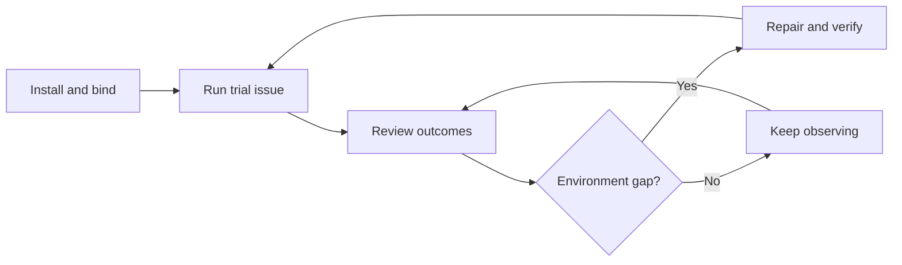

# Software Factory administrator guide

Install a factory, prepare its repository runner, and improve it from
observed outcomes. Developers then use the [user guide](factory-user-guide.md).



## Set up the factory

Choose a [supported issue tracker and code host](dark-factory-quickstart.md#choose-your-tracker-and-code-host).
For a laptop trial, follow the [local quickstart](dark-factory-quickstart.md).
It creates an isolated kind cluster and needs at least 16 GiB of Docker memory.

For an organizational install, choose the repository and an **existing**
Kubernetes context. Complete the quickstart's [CLI installation and model-key
steps](dark-factory-quickstart.md#install-curie), then keep your normal
kubeconfig. Check the context before installing:

```bash
kubectl config get-contexts
read -r -p "Factory Kubernetes context: " CURIE_CONTEXT
kubectl --context "$CURIE_CONTEXT" cluster-info
read -r -p "Code repository path: " CURIE_REPO
CURIE_NAMESPACE=curie
CURIE_RELEASE=curie
```

Use your existing namespace and release names if Curie is already installed.
Follow the matching provider commands in the [quickstart](dark-factory-quickstart.md#start-the-factory),
but skip its isolated kubeconfig and kind-name block. Replace `--kind-name`
with `--context "$CURIE_CONTEXT"` on the first pass, keep `--context` on
later passes, and add
`--namespace "$CURIE_NAMESPACE" --release "$CURIE_RELEASE"` to every pass.
The [existing-cluster example](factory-quickstart-reference.md#choose-the-target-and-run-the-command)
shows both GitHub App passes. Jira Cloud also needs its own account and token;
GitLab needs a project token. The provider sections give their exact flags.

Confirm the setup names the intended context, repository, label, and runner:

```bash
curie cluster status --context "$CURIE_CONTEXT" \
  --namespace "$CURIE_NAMESPACE" --release "$CURIE_RELEASE"
```

Run one small issue with an authorized labeler. Read its final status and linked
PR or merge request before onboarding more repositories.

Use [operations](../operations.md) and the
[factory bundle reference](../../examples/dark-factory/README.md#deploy-it-as-the-factory-agent)
for production settings.

## Prepare a repository runner

Install the local skills in the repository checkout:

```bash
curie factory skills install --agent codex
```

Replace `codex` with `claude-code`, `copilot`, `gemini`, or `cursor`
for your client. If `skills` is unrecognized, use the
[source checkout instructions](factory-preparation.md#install-from-a-source-checkout).
Then ask for a proposal:

```text
Review the runner environment for <repository binding> and propose
any changes needed for factory work.
```

This should select the installed `factory-environment-setup` skill. It
compares repository checks and recent work with the runner image.
Review its tool versions, checks, access needs, and rollback digest. Approve
a concrete change, then verify the new digest and run checks in a sandbox
claim. Restore the old binding if checks fail. See
[runner setup details](factory-environments.md#review-the-setup-proposal).

## Improve it from outcomes

```bash
curie cluster work-items --agent dark-factory
```

```text
Review factory failures for <factory> over the last 30 days and
propose repairs.
```

This should select the installed `factory-environment-maintenance` skill.
Review grouped failures and a proposed repair. Image tools belong in the
runner; network, credentials, CI, capacity, and instructions have other
owners. Compare outcomes in a later window. The maintenance skill neither
changes bindings nor retries old issues. See [maintenance details](factory-environments.md#review-failures-over-time)
and [outcome measurement](measuring-factory-outcomes.md).

For approvals, models, budgets, and stop controls, use the
[co-worker administrator guide](../administering-co-workers.md).
