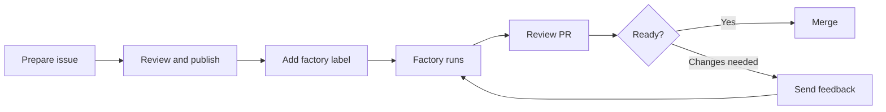

# Software Factory user guide

Prepare an issue locally. Curie implements it. You verify and merge the PR.



Start with a [configured factory](factory-admin-guide.md), a repository
checkout, and GitHub write access. This example uses GitHub for issues and
code. For other [supported pairings](../capabilities.md#workspaces-and-integrations),
use their provider quickstart.

## Try a small issue

1. **Install the local skills** from your repository checkout:

   ```bash
   curie factory skills install --help && curie factory skills install --agent codex
   ```

   Replace `codex` with `claude-code`, `copilot`, `gemini`, or `cursor`
   for your client. If `skills` is unrecognized, use the
   [source checkout instructions](factory-preparation.md#install-from-a-source-checkout).
   Installation does not deploy the factory.

2. **Prepare the issue** in your coding agent:

   ```text
   Use the prepare-factory-ticket skill to add greeting.md with exactly
   "# Hello, factory" and a final newline. Include this verification command:
   `printf '# Hello, factory\n' | cmp - greeting.md`
   ```

   Review the full issue. For existing work, give the skill the issue URL.
   See [ticket preparation](factory-preparation.md).

3. **Start the factory.** Choose **publish and start the factory** after
   approving the issue. Confirm the repository and label. The GitHub default
   is `curie-factory`. If your agent cannot publish, post the approved issue
   and add the label yourself. A label means selected for intake. The factory's
   status comment confirms admission.

4. **Watch the issue.** `curie-factory:queued` and
   `curie-factory:running` show admitted work. `curie-factory:pr-open`
   links the PR. Read the final `Completed:` or `Could not complete:`
   status after CI; an open PR alone is not completion.

5. **Verify the PR.** Open its link and run:

   ```text
   Use the review-pr skill to inspect <pr-url> and guide my local checks.
   ```

   Compare the diff with the issue, inspect CI, and run local checks. For
   the example, run the `cmp` command in the PR checkout. See
   [guided PR review](factory-pr-review.md).

6. **Finish or revise.** Approve the feedback that `review-pr` proposes.
   A new authorized comment or review mentioning the configured App can
   request a factory revision. Review the new PR head. When satisfied,
   explicitly ask the skill to merge or use your team's merge process.
   Curie does not merge its own PR.

To cancel, remove the label or close the issue. Inspect existing work before
adding the label again. See [retry rules](../software-factory.md#delegate-inspect-and-refine).
