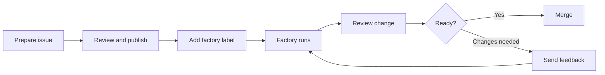

# Software Factory user guide

Prepare an issue locally. Curie implements it. You verify and merge the pull
request or merge request.



Start with a [configured factory](factory-admin-guide.md), a repository
checkout, permission to select an issue, and access to review the resulting
change. The same flow applies to each [supported pairing](../capabilities.md#workspaces-and-integrations).

## Try a small issue

1. **Install the local skills** from your repository checkout:

   ```bash
   curie factory skills install --agent codex
   ```

   Replace `codex` with `claude-code`, `copilot`, `gemini`, or `cursor`
   for your client. If `skills` is unrecognized, use the
   [source checkout instructions](factory-preparation.md#install-from-a-source-checkout).
   Installation does not deploy the factory.

2. **Prepare the issue** in your coding agent:

   ```text
   Prepare this change for the Software Factory: add greeting.md with exactly
   "# Hello, factory" and a final newline. Include this verification command:
   `printf '# Hello, factory\n' | cmp - greeting.md`
   ```

   This should select the installed `prepare-factory-ticket` skill. Review
   the full issue. For existing work, provide the issue URL.
   See [ticket preparation](factory-preparation.md).

3. **Start the factory.** Choose **publish and start the factory** after
   approving the issue. Confirm the repository and configured trigger label;
   `curie-factory` is the usual default. If your agent cannot publish, post
   the approved issue and add the label yourself. A label means selected for
   intake. The factory's status comment confirms admission.

4. **Watch the issue.** State labels and the factory's status comment show
   progress. Follow its link to the pull request or merge request. Read the
   final `Completed:` or `Could not complete:` status after CI; an open change
   alone is not completion.

5. **Verify the change.** Open its link and ask your coding agent:

   ```text
   Walk me through this pull request or merge request and help me test it
   locally: <change-url>
   ```

   This should select the installed `review-pr` skill when your client supports
   it. Compare the diff with the issue, inspect CI, and run local checks. For
   the example, run the `cmp` command in the change checkout. See
   [guided PR review](factory-pr-review.md).

6. **Finish or revise.** Approve the feedback your coding agent proposes.
   To request a factory revision, post it through the configured issue or
   review route and mention the factory identity as that provider requires.
   Review the new change head. When satisfied, explicitly ask your agent to
   merge or use your team's merge process. Curie does not merge its own change.

To cancel, remove the label or close the issue. Inspect existing work before
adding the label again. See [retry rules](../software-factory.md#delegate-inspect-and-refine).
