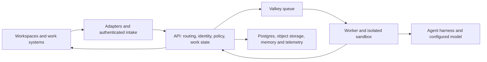

# Platform capabilities and boundaries

Curie connects supported agents to shared work. A workspace message or a labelled
engineering issue enters through a configured integration. The platform
authenticates the source, records work and authority in its own services, and
runs an agent bundle in an isolated sandbox. The result returns to the
originating workspace or work system. The [capability reference](capabilities.md)
is the source for release status and provider limits; this page explains how
the platform pieces fit together.

## Component map

The arrows show a common path, not one universal connector. A Slack mention
and a factory issue use different intake and return paths. The
[as built architecture](../ARCHITECTURE.md#component-map) names the services,
stores and message flows in more detail.

## Workspace and work system connections

Adapters translate provider events into platform requests and return replies
through the provider that received the work. The receiving route determines
which agent and channel identity handle a message. Factory intake instead
admits an issue from a configured tracker and code host pairing, then follows
the resulting pull request or merge request.

A connection to one provider does not authorize another. Slack conversation
support is released. Discord has a separate adapter with limits. The shipped
AgentMail adapter currently refuses inbound email because it cannot establish
sender authentication Curie can verify. There is no supported first party
Teams channel. Factory support varies by tracker and code host pairing; consult
[workspaces and integrations](capabilities.md#workspaces-and-integrations)
before selecting one. See [message flow](diagrams/message-flow.md) and the
[Software Factory overview](software-factory.md) for the two primary paths.

## Identity and authorization

Curie separates the account that sent an event from the person it represents.
A tenant scoped principal identifies a person by IdP issuer and subject.
Directory sync projects IdP people, account status, groups and known channel
accounts into Curie. A provider account can be linked to a principal inside
the namespace where that provider's native user ID is meaningful. An agent can
name separate invocation and approver teams; the API checks current membership
when a supported path invokes the agent or resolves an approval.

These are scoped mechanisms, not a promise that every provider actor resolves
to one person. The current account link resolver has a Slack realization;
email resolution requires both an authenticated sender and a link in an IdP
governed domain, while the shipped AgentMail inbound path remains unavailable.
Factory tracker admission and code host publication use their own provider
authority checks. A bot identity by itself does not prove a shared human
identity. See the [identity design](adr/0220-one-identity-provider-decides-who-may-invoke-and-approve-on-every-channel.md),
[namespace design](adr/0198-identity-links-live-in-provider-identity-namespaces.md),
and [administrator guidance](administering-co-workers.md#bind-workspaces-and-credentials-deliberately).

## Scoped context and memory

The platform can load agent facts across that agent's bindings and channel
facts for the current binding. Memory writes require enabled tools and scoped
credentials. This does not copy complete conversations across channels or
automatically extract facts from every turn. Factory issue, review and CI state
is durable work item state, distinct from memory facts. See the
[memory contract](interfaces/memory/INTERFACE.md) and
[memory administration](administering-co-workers.md#govern-what-is-remembered).

## Execution and models

The API and worker keep work state and dispatch runnable turns through Valkey.
The worker starts or reuses an isolated runner. A versioned bundle supplies
instructions and tools; the shipped harness uses the Claude Agent SDK. The
sandbox receives scoped capabilities for the work it may read or report.
Repository publication credentials stay with trusted platform services rather
than the factory sandbox.

Operators select implementation and reviewer models explicitly. Supported
routes include Anthropic, OpenRouter, compatible provider endpoints and opt in
local Ollama, subject to provider compatibility and allowed egress. The
harness interface permits future extensions, but arbitrary agent runtimes and
automatic model choice by task complexity are not supported promises. See
[execution architecture](../ARCHITECTURE.md#one-worker-two-hidden-seams-substrate-and-transport),
[model providers](interfaces/model-provider/INTERFACE.md), and
[existing agent limits](capabilities.md#existing-agents-and-models).

## Controls and evidence

Approval routes determine who may resolve a pending action. Tool policy and
external service permissions are separate checks; approval does not enlarge a
repository token or connector role. Factory publication runs through a trusted
service outside the sandbox. New agents default to human publication approval;
the local quickstart opts into automatic initial publication. Neither mode
merges the resulting pull request.

Administrators can configure model roles, execution bounds and memory writes.
The current USD budget field is a session ceiling passed to the SDK, not an
aggregate daily ledger. Work item views expose status, CI outcomes, usage and
estimated model cost. A pull request, passing checks or an estimate does not
establish accepted work or measured return on investment. Those conclusions
require a defined cohort, provider billing reconciliation and human effort.
See [approvals](approvals.md), [factory review and publication](software-factory.md#what-review-and-publication-enforce),
[budget limits](administering-co-workers.md#configure-model-roles-and-bounded-runs),
and [outcome measurement](guides/measuring-factory-outcomes.md).

## One Software Factory run

1. A permitted person labels a bounded issue in a configured tracker. Factory
   intake verifies the installation, repository or project policy, and sender
   authority before recording a work item and execution request.
2. The API reconciler places due work on the queue. The worker claims it and
   starts an isolated runner with scoped issue read and progress capabilities.
3. The bundle plans, implements and verifies the change. It can request
   clarification or end with a classified failure instead of a pull request.
4. The sandbox requests publication. A separate approval and publication path
   applies the agent's policy, then a trusted job pushes the branch and the
   platform opens or updates the pull request.
5. The API observes CI on the published head. A failing check may start a
   bounded repair round. Unreadable or missing required evidence does not
   become a passing result.
6. The issue and operator surfaces show progress, result, CI and estimated
   usage. Engineers inspect and merge an acceptable pull request themselves.

The [factory component map and sequence](../ARCHITECTURE.md#factory-work-items-and-publication)
give the implementation detail. The [factory guide](software-factory.md)
and [capability reference](capabilities.md) describe prerequisites and
supported combinations.
